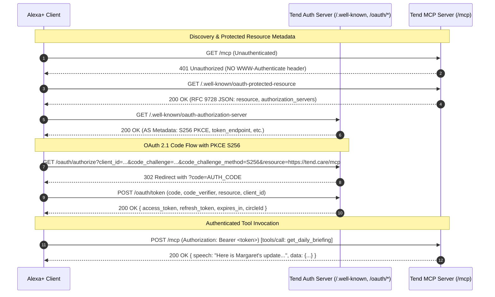

# Tend Architecture Specification & Threat Model (`docs/SPEC.md`)

> **Document Version:** `spec-v1`  
> **Target:** Alexa+ Add-on & MCP Server (`apps/mcp-server`)  
> **Reference Design Standard:** [`DESIGN.md`](../DESIGN.md)

---

## 1. Personas

```
 ┌─────────────────────────┐       ┌─────────────────────────┐       ┌─────────────────────────┐
 │   Margaret (Elder)      │       │ Elena (Primary Care)    │       │  David (Secondary Care) │
 │   Age: 81               │       │ Age: 48 (Daughter)      │       │  Age: 45 (Son)          │
 │   Role: "elder"         │       │ Role: "primary_care"    │       │  Role: "caregiver"      │
 │   Surface: Echo Show 8  │       │ Surface: Echo Dot / App │       │  Surface: Alexa+ Mobile │
 └─────────────────────────┘       └─────────────────────────┘       └─────────────────────────┘
```

### Persona 1: Margaret (Elder, 81)
- **Context:** Lives independently at home. Has mild hypertension, arthritis, and routine morning/evening medications. Dislikes complex smartphone apps, small touch targets, and passcode screens.
- **Goals:** Maintain her independence without being micromanaged; easily confirm routines without feeling monitored.
- **Voice Habit:** Speaks casually to the Echo Show in her kitchen while preparing tea or breakfast.

### Persona 2: Elena (Primary Caregiver / Daughter, 48)
- **Context:** Works full-time, lives 20 minutes from Margaret. Coordinates doctors, pharmacy refills, and daily check-ins. Carries the cognitive load of wondering whether Mom took her meds or is doing fine.
- **Goals:** Get rapid, trusted daily briefings without calling repeatedly or nagging her mother.
- **Voice Habit:** Asks Alexa while getting ready in the morning: *"Alexa, how's Mom doing today?"*

### Persona 3: David (Secondary Caregiver / Son, 45)
- **Context:** Lives in another city. Handles weekend visits, grocery orders, and specialist appointments.
- **Goals:** Collaborate with Elena on care tasks without duplicate phone calls or conflicting pharmacy pickups.
- **Voice Habit:** Checks and claims tasks using voice and glances at the visual Care Board on Echo devices.

---

## 2. Voice Journeys & Utterance Models

### Journey 1: Elder Logs Scheduled Medication
- **User:** Margaret (Elder)
- **Sample Utterances:**
  - *"Alexa, tell Tend I took my morning pills."*
  - *"Alexa, ask Tend to log my meds."*
  - *"Alexa, tell Tend I skipped my evening dose."*
- **Spoken Response (<= 280 chars):**
  *"I've logged your morning blood pressure medication as taken for today. Have a lovely morning, Margaret."*
- **Structured Data:** `{ action: "log_medication", doseId: "med-01", status: "taken", timestamp: "2026-10-23T08:15:00Z" }`

### Journey 2: Elder Routine Well-Being Check-In
- **User:** Margaret (Elder)
- **Sample Utterances:**
  - *"Alexa, tell Tend I'm fine."*
  - *"Alexa, tell Tend I'm doing well today."*
  - *"Alexa, tell Tend I woke up feeling a little tired."*
- **Spoken Response (<= 280 chars):**
  *"Thank you for checking in, Margaret. I've let Elena and David know you're doing well today."*
- **Structured Data:** `{ action: "record_check_in", status: "fine", note: "woke up feeling a little tired", timestamp: "2026-10-23T08:20:00Z" }`

### Journey 3: Caregiver Daily Spoken Briefing
- **User:** Elena (Primary Caregiver)
- **Sample Utterances:**
  - *"Alexa, ask Tend how Mom is doing today."*
  - *"Alexa, get my Tend daily briefing."*
  - *"Alexa, ask Tend for the morning care report."*
- **Spoken Response (<= 280 chars):**
  *"Here is Margaret's update: Morning pills were taken at 8:15 AM. Check-in was logged at 8:20 AM. There is 1 open task: pick up prescription refill, and an appointment with Dr. Chen on Thursday at 2 PM."*
- **Structured Data:** `{ circleId: "circle-123", elderName: "Margaret", adherence: "1/1 taken", checkIn: "fine", openTasks: 1, nextAppointment: "2026-10-29T14:00:00Z" }`

### Journey 4: Caregiver Task Review & Claiming
- **User:** David or Elena (Caregiver)
- **Sample Utterances:**
  - *"Alexa, ask Tend what care tasks are open."*
  - *"Alexa, tell Tend to claim the prescription task."*
- **Spoken Responses:**
  - Task List: *"There is 1 open care task: Pick up blood pressure refill at CVS, due today by 5 PM."*
  - Claiming: *"You have claimed the prescription refill task, David. I've updated Elena and the family care board."*
- **Structured Data:** `{ taskId: "task-401", title: "Pick up blood pressure refill", status: "claimed", claimedBy: "David" }`

### Journey 5: Family Care Note
- **User:** Any Circle Member
- **Sample Utterances:**
  - *"Alexa, tell Tend to add a note: Mom's knee is feeling much better after physical therapy."*
  - *"Alexa, tell Tend to add a note: The heating repair technician is coming tomorrow at 10 AM."*
- **Spoken Response (<= 280 chars):**
  *"Care note added: Mom's knee is feeling much better after physical therapy. I've shared it with the circle."*
- **Structured Data:** `{ noteId: "note-802", author: "Elena", content: "Mom's knee is feeling much better after physical therapy" }`

### Journey 6: Urgent Circle Alert (Explicit Confirmation Required)
- **User:** Caregiver
- **Sample Utterances:**
  - Step 1: *"Alexa, ask Tend to notify the circle: Mom hasn't answered her phone all morning."*
  - Prompt: *"Are you sure you want to broadcast an urgent alert to all 3 circle members via SMS? Say confirm to proceed."*
  - Step 2: *"Confirm"*
- **Spoken Response (<= 280 chars):**
  *"Urgent alert sent to 3 circle members via SMS: Mom hasn't answered her phone all morning."*
- **Structured Data:** `{ notificationId: "notif-901", severity: "urgent", confirmed: true, recipientsCount: 3 }`

---

## 3. Tool Catalog (8 Focused Tools)

All tools return the standard envelope:
```typescript
interface ToolResultEnvelope<T = Record<string, unknown>> {
  speech: string; // Plain text, <= 280 characters, no markdown
  data: T;
}
```

### 1. `log_medication`
- **Description:** Record taken or skipped for a scheduled dose.
- **Input Schema:**
```json
{
  "type": "object",
  "properties": {
    "slot": { "type": "string", "enum": ["morning", "afternoon", "evening", "bedtime"], "description": "Time slot of the medication dose" },
    "status": { "type": "string", "enum": ["taken", "skipped"], "description": "Whether the medication was taken or skipped" },
    "notes": { "type": "string", "maxLength": 100, "description": "Optional brief note" }
  },
  "required": ["slot", "status"]
}
```

### 2. `record_check_in`
- **Description:** Record daily well-being check-in with an optional status note.
- **Input Schema:**
```json
{
  "type": "object",
  "properties": {
    "status": { "type": "string", "enum": ["fine", "great", "tired", "needs_help"], "description": "Elder well-being indicator" },
    "note": { "type": "string", "maxLength": 140, "description": "Optional spoken note from elder" }
  },
  "required": ["status"]
}
```

### 3. `get_daily_briefing`
- **Description:** Spoken deterministic briefing summarizing meds, check-ins, tasks, and appointments.
- **Input Schema:**
```json
{
  "type": "object",
  "properties": {
    "date": { "type": "string", "pattern": "^\\d{4}-\\d{2}-\\d{2}$", "description": "Date in YYYY-MM-DD format (defaults to today)" }
  }
}
```

### 4. `list_care_tasks`
- **Description:** List open family care coordination tasks.
- **Input Schema:**
```json
{
  "type": "object",
  "properties": {
    "filter": { "type": "string", "enum": ["open", "claimed", "all"], "default": "open" }
  }
}
```

### 5. `claim_care_task`
- **Description:** Claim an open care task so siblings do not duplicate effort.
- **Input Schema:**
```json
{
  "type": "object",
  "properties": {
    "taskId": { "type": "string", "description": "Unique identifier of the care task" }
  },
  "required": ["taskId"]
}
```

### 6. `add_care_note`
- **Description:** Post a shared update or observation to the family care circle.
- **Input Schema:**
```json
{
  "type": "object",
  "properties": {
    "note": { "type": "string", "minLength": 3, "maxLength": 280, "description": "Message content for family care board" }
  },
  "required": ["note"]
}
```

### 7. `list_appointments`
- **Description:** Check upcoming medical and caregiver appointments for the circle.
- **Input Schema:**
```json
{
  "type": "object",
  "properties": {
    "daysAhead": { "type": "integer", "minimum": 1, "maximum": 30, "default": 7 }
  }
}
```

### 8. `notify_circle`
- **Description:** Broadcast an escalation alert to family circle members with explicit confirmation.
- **Input Schema:**
```json
{
  "type": "object",
  "properties": {
    "message": { "type": "string", "minLength": 5, "maxLength": 200, "description": "Alert message text" },
    "confirm": { "type": "boolean", "description": "Must be true to dispatch the alert" }
  },
  "required": ["message", "confirm"]
}
```

---

## 4. DynamoDB Single-Table Design (`tend-main-table`)

### Key Design
- **Partition Key (`PK`):** String
- **Sort Key (`SK`):** String
- **GSI1 Partition Key (`GSI1PK`):** String
- **GSI1 Sort Key (`GSI1SK`):** String

### Entity Table Layout

| Entity | PK | SK | GSI1PK | GSI1SK | Attributes |
|---|---|---|---|---|---|
| **Circle Metadata** | `CIRCLE#<circleId>` | `METADATA` | `ORG#tend` | `CREATED#<iso>` | `name`, `elderName`, `timezone`, `createdAt` |
| **Member** | `CIRCLE#<circleId>` | `MEMBER#<memberId>` | `USER#<userId>` | `ROLE#<role>` | `name`, `role`, `phone`, `email` |
| **Medication Schedule** | `CIRCLE#<circleId>` | `MED#<medId>` | `MED#<medId>` | `SLOT#<slot>` | `name`, `dosage`, `slot`, `frequency`, `active` |
| **Dose Event (Idempotent)** | `CIRCLE#<circleId>` | `DOSE#<date>#<slot>` | `CIRCLE#<circleId>` | `DOSE#<timestamp>` | `slot`, `status` (taken/skipped), `loggedBy`, `timestamp` |
| **Check-in Event** | `CIRCLE#<circleId>` | `CHECKIN#<date>` | `CIRCLE#<circleId>` | `CHECKIN#<timestamp>` | `status`, `note`, `timestamp` |
| **Care Task** | `CIRCLE#<circleId>` | `TASK#<taskId>` | `CIRCLE#<circleId>` | `STATUS#<status>#<due>` | `title`, `status`, `dueAt`, `claimedBy`, `claimedAt` |
| **Care Note** | `CIRCLE#<circleId>` | `NOTE#<timestamp>` | `CIRCLE#<circleId>` | `NOTE#<timestamp>` | `author`, `content`, `timestamp` |
| **Appointment** | `CIRCLE#<circleId>` | `APPT#<date>#<apptId>` | `CIRCLE#<circleId>` | `DATE#<date>` | `title`, `doctor`, `location`, `dateTime` |
| **Audit Log (Append-only)** | `CIRCLE#<circleId>` | `AUDIT#<timestamp>#<rand>` | `ACTION#<action>` | `USER#<memberId>` | `action`, `actorId`, `ip`, `payloadHash` |
| **Bedrock Cached Insight** | `CIRCLE#<circleId>` | `INSIGHT#LATEST` | `INSIGHT#LATEST` | `DATE#<date>` | `summary`, `adherenceTrend`, `generatedAt`, `modelId` |

### Access Patterns & Queries

| Pattern ID | Access Pattern | Method | Key Condition | Target Latency |
|---|---|---|---|---|
| **AP-1** | Get Circle & Members | Query | `PK = CIRCLE#<circleId> AND SK begins_with(MEMBER#)` | $< 25\text{ ms}$ |
| **AP-2** | Daily Briefing Synthesis | Batch/Query (Parallel) | 1) `DOSE#<today>` 2) `CHECKIN#<today>` 3) GSI1 open tasks 4) `APPT#<today>` | $< 45\text{ ms}$ (Total) |
| **AP-3** | Log Dose (Idempotent) | PutItem | `PK = CIRCLE#<circleId>`, `SK = DOSE#<date>#<slot>` (attribute_not_exists or overwrite) | $< 20\text{ ms}$ |
| **AP-4** | Claim Task | UpdateItem | Condition: `attribute_exists(PK) AND (attribute_not_exists(claimedBy) OR claimedBy = :none)` | $< 25\text{ ms}$ |
| **AP-5** | List Open Tasks | Query GSI1 | `GSI1PK = CIRCLE#<circleId> AND GSI1SK begins_with(STATUS#open)` | $< 20\text{ ms}$ |

---

## 5. OAuth 2.1 & RFC 9728 Architecture



### Alexa+ Hard Authentication Rules:
1. **Unauthenticated /mcp:** Strict HTTP `401 Unauthorized` with **NO** `WWW-Authenticate` header.
2. **PKCE:** Exclusively `S256`. Plain challenge method returns `400 invalid_request`.
3. **Resource Parameter:** `resource=https://tend.care/mcp` strictly validated on both `/oauth/authorize` and `/oauth/token`. Mismatched resource returns `400 invalid_target`.
4. **Bearer Header Only:** Query string token access is rejected with `401`.

---

## 6. STRIDE Threat Model

| Threat Category | Potential Attack Vector | Impact | Mitigations in Tend |
|---|---|---|---|
| **Spoofing** | Attacker crafts forged Alexa request or impersonates circle member | Access to elder medication & home routine data | Strict OAuth 2.1 PKCE verification; tokens cryptographically signed (HMAC-SHA256/Ed25519) and bound to `circleId` and `memberId`. |
| **Tampering** | Modification of dose logs or task assignments | Elder takes double dose or missed doses | Idempotent deterministic keys (`DOSE#<date>#<slot>`); append-only audit trail for all state mutations; conditional writes in DynamoDB. |
| **Repudiation** | Sibling disputes claiming a task or triggering an alert | Family conflict, unexecuted care tasks | Every write event records immutable `actorId`, timestamp, and client IP in the append-only audit log. |
| **Information Disclosure** | Cross-tenant data leakage between family care circles | Highly sensitive personal health data leaked | Strict multi-tenancy partition key enforcement (`PK = CIRCLE#<circleId>`). All queries enforce circle isolation derived directly from verified JWT claims. |
| **Denial of Service** | Flooding MCP server with synthetic tool invocations | Service outage prevents emergency notifications | Rate limiting (10 req/sec per circle, 50 req/sec IP); sub-500ms deterministic execution prevents thread exhaustion; CloudWatch alarms. |
| **Elevation of Privilege** | Caregiver alters circle configuration or deletes elder records | Elder care record hijacked | Role-Based Access Control (RBAC): `elder`, `primary_caregiver`, `caregiver`. Risky operations (`notify_circle`) require explicit confirmation. |

---

## 7. Error Taxonomy & Spoken Failures

| Error Code | HTTP Status | Spoken Speech ($\le 280$ characters) | Internal Recovery Action |
|---|---|---|---|
| `UNAUTHENTICATED` | 401 | *"Please link your Tend account in the Alexa app to manage your family care circle."* | Return bare 401. Trigger account linking card. |
| `FORBIDDEN_CIRCLE` | 403 | *"You don't have permission to access this care circle."* | Audit log access violation; reject request. |
| `INVALID_INPUT` | 400 | *"I couldn't quite understand that. You can tell me to log morning pills or ask for Mom's daily update."* | Return Zod field violation details in `data.details`. |
| `ACTION_CONFIRM_REQUIRED` | 400 | *"This action requires confirmation. Please say confirm to send this alert to the family."* | Return confirmation challenge payload. |
| `TASK_ALREADY_CLAIMED` | 409 | *"That care task was already claimed by David. No need to worry about it."* | Return 409 Conflict with current assignee. |
| `RATE_LIMITED` | 429 | *"Tend is receiving too many requests right now. Please try again in a few moments."* | 429 Too Many Requests + `Retry-After: 5`. |
| `SERVICE_UNAVAILABLE` | 503 | *"Tend is having trouble connecting to the care network. Please try again shortly."* | Emit CloudWatch high-priority alarm. |

---

## 8. Latency Budget ($p95 < 250\text{ ms}$ Locally, $< 500\text{ ms}$ Global)

```
Total Budget: 250 ms (Local Target)
├── ALB / Network Ingress:          ~5 ms
├── TLS & HTTP Termination:         ~5 ms
├── Hono Middleware & JWT Auth:     ~10 ms
├── Parallel DynamoDB Reads (<=4):  ~40 ms
├── Deterministic Briefing Template:~5 ms
├── Serialization & Response:       ~5 ms
└── Total Estimated Latency:        ~70 ms (Margin: 180 ms)
```

**Architectural Directives:**
1. **Zero LLM Calls in Synchronous Path:** `get_daily_briefing` runs pure deterministic template interpolation over the 4 queried records.
2. **Asynchronous Insights:** Bedrock Converse API runs via background EventBridge cron schedule, storing pre-computed summary bullets in `INSIGHT#LATEST`. The briefing simply includes the cached bullet if available.

---

## 9. Open Architectural Questions for User Confirmation

1. **Circle Size Limits:** Should a free tier Tend circle be capped at 5 family members, with a single designated elder per circle?
2. **Emergency Disclaimer Prompting:** Should the voice briefing include a brief reminder (*"Tend is for routine coordination, not medical emergencies"*) on initial morning setup or only during account linking?
3. **SMS Alert Provider:** For Phase 5 SNS escalation alerts, should we rely on Amazon SNS SMS directly, or support email notifications as a free fallback during local testing?
4. **Timezone Normalization:** Should elder schedule slots (morning, evening) be anchored to the elder's local timezone stored in circle metadata?
5. **Care Board Refresh Cadence:** For the MCP App UI (`ui://tend/care-board`), should the care board poll the server every 30 seconds or refresh on focus/touch events?
